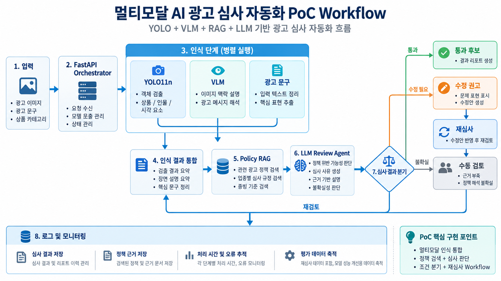

# AI 코어 프로젝트

Python 3.12 기반 멀티모달 인식 프로젝트. 최종 목표는 F101~F106이며 현재는 **환경 구성·F101·F102·F103을 구현**했다.
요구사항은 로컬 `16-C-2-01.pdf` 3~5쪽을 확인했다. 교육 원문·제공 소스·모델·이미지를
복제하거나 공개하지 않으며 기존 `source/`, `models/`, `.venv/`를 보존한다.

## 광고 심사 확장 구상



사용자가 제공한 광고 심사 확장 구상도다. 현재 구현 완료 범위는 F101·F102·F103이며,
FastAPI 인식 통합은 F103에서 구현하며, 그림의 정책 RAG·LLM 심사·재심사·모니터링은 향후 구현 구상이다.

## 환경 준비

현재 Windows 가상환경 `.venv`의 Python은 3.12.10이다. 이미 구성된 가상환경은 그대로 사용한다.
새 PC에서만 다음 명령으로 만든다.

```powershell
py -3.12 -m venv .venv
.\.venv\Scripts\python.exe -m pip install --upgrade pip
.\.venv\Scripts\python.exe -m pip install -e .
```

명세서 필수 패키지 Ultralytics, **llama-cpp-python==0.3.34**, FastAPI, Uvicorn,
huggingface_hub와 측정용 Torch/psutil/Pillow를 `pyproject.toml`에 정의했다.
명세서가 버전을 지정하지 않은 패키지는 기존 환경에서 검증한 버전으로 고정했다.
CPU를 기본 실행 기준으로 사용한다. CUDA용 Torch는 장치·드라이버와 맞는 빌드를 별도로 설치해야 한다.
Windows에서 llama-cpp-python wheel을 사용할 수 없는 경우 CMake와 Visual Studio C++ 빌드 도구가 필요할 수 있다.

현재 환경에는 필수 패키지가 이미 있어서 다음 명령으로 로컬 프로젝트만 등록하고 검증했다.

```powershell
.\.venv\Scripts\python.exe -m pip install --no-build-isolation --no-deps -e .
.\.venv\Scripts\python.exe -m pip check
.\.venv\Scripts\python.exe -m experiments.check_environment
```

VS Code에서 Python: Select Interpreter로 `.venv\Scripts\python.exe`를 선택한다.
`.vscode/`에는 인터프리터·단위 테스트·수동 벤치마크 task와 디버깅 구성을 제공한다.
디버깅할 때는 `.env.example`을 `.env`로 복사할 수 있다. CLI와 task는 `.env`를 자동으로 읽지 않으며
프로세스 환경변수 또는 CLI 옵션을 사용한다. 예: `$env:MODEL_DEVICE = 'cpu'`.
기본 경로는 `app/config.py`에 있고 상대 경로는 프로젝트 루트 기준이다.

환경 점검 결과는 `artifacts/environment.json`에 저장한다. Python 3.12, 필수 import,
llama_cpp 0.3.34, 모델·샘플 파일 존재, 장치와 RAM을 검사한다. 실패 시 종료 코드 1이다.
이 단계에서 VLM을 로드하거나 추론하지 않는다.

## 모델과 입력

기본 YOLO 가중치는 루트 `yolo11n.pt`, 입력은 기존
`source/2회차_day1/samples/sample.jpg`이다. 파일을 복사하거나 수정하지 않고 원래 경로에서 읽는다.
VLM 본체와 mmproj는 `models/`에 있으며 F102 비교 스크립트에서 사용한다.

별도 환경에서는 사용 허가된 실제 JPEG와 공식 YOLO11n 가중치를 준비하고 다음처럼 경로를 지정한다.
샘플이나 가중치가 없으면 임의 파일을 생성하지 않으며 자동 다운로드도 하지 않는다.
모델 준비는 [Ultralytics 공식 YOLO11 문서](https://docs.ultralytics.com/models/yolo11/)를 따른다.

```powershell
.\.venv\Scripts\python.exe -m experiments.f101_yolo_benchmark --weights yolo11n.pt --image "source/2회차_day1/samples/sample.jpg" --device cpu --repeats 10 --warmup 1 --imgsz 640
```

기본 경로를 쓰면 `python -m experiments.f101_yolo_benchmark`만으로도 실행할 수 있다.
실패 시 종료 코드 1을 반환하며 성공 측정값을 대신 생성하지 않는다. 이전 CSV가 있으면 그대로
남을 수 있으므로 성공 메시지와 `run_id`를 확인한다. 성공 실행은 같은 이름의 CSV를 덮어쓴다.
이전 실행을 보존하려면 `--output-dir artifacts/run02`처럼 출력 디렉터리를 바꾼다.

## F101 출력과 측정 방식

- `artifacts/measurement.csv`: conf별 평균·최소·중앙·p95·최대 지연, FPS, 첫 호출,
  모델 로딩 시간, 프로세스 RSS 전후와 증가량.
- `artifacts/f101_iterations.csv`: 워밍업을 제외한 반복별 지연과 RSS. 기본 30행이다.
- `artifacts/f101_conf_sweep.csv`: conf별 검출 수와 bbox/class/confidence JSON.
  같은 검출 결과를 콘솔에도 출력한다. bbox는 원본 이미지 픽셀의 `[x1,y1,x2,y2]`다.

모든 CSV에 실행 ID(UTC), Python/OS/Torch/Ultralytics, 장치, 이미지 크기, imgsz,
입력·가중치 경로 및 SHA256을 기록한다. 원본 이미지나 주석 이미지는 저장하지 않는다.

다음은 명세서에 고정되지 않은 **본 구현의 설계 선택**이다.

- 세 conf를 0.10 → 0.25 → 0.60 순서로 같은 모델과 같은 JPEG에 적용한다.
- conf당 기본 10회 반복하고, 첫 호출을 포함해 `--warmup`회는 통계에서 제외한다.
  첫 conf의 첫 호출만 cold이며 이후 conf는 이미 초기화된 모델을 사용한다.
- 지연은 JPEG 읽기·전처리·추론·후처리를 포함한 `predict()` 호출 wall time이다.
  모델 로딩과 JSON 직렬화는 제외하고 별도로 기록한다. GPU 실행은 측정 전후 동기화한다.
- FPS는 `1 / 평균 추론 초`, p95는 nearest-rank다.
- 메모리는 호출 사이의 프로세스 RSS를 샘플링한다. conf 시작 전 대비 마지막 호출 후
  차이를 증가량으로 기록한다. 모델 로딩 전후 증가량도 별도 기록한다.
  피크 메모리·VRAM 측정은 아니며, 메모리 회수에 따라 증가량은 음수일 수 있다.
- sweep CSV의 bbox/class/confidence는 각 conf의 마지막 반복 결과다.

첫 conf에 초기 메모리 할당 비용이 집중될 수 있으므로 conf별 RSS 차이를 모델 크기 차이로
해석하지 않는다. 이미지 한 장으로는 정확도/mAP를 측정할 수 없고, 후보 비교의 공개 지표와
이 PC의 실측은 구분한다. [모델 선정 근거](docs/f101_model_selection.md)와
[검증 결과](docs/f101_validation.md)를 참조한다.

## 테스트와 현재 범위

```powershell
.\.venv\Scripts\python.exe -m unittest discover -s tests -v
```

단위 테스트는 가짜 모델·시계·메모리로 계산·워밍업 분리·CSV·누락/손상 입력 처리를 검증한다.
임시 테스트 파일을 실제 측정으로 사용하지 않는다. 실제 모델 실행 결과는 별도로 기록했다.

환경 점검과 F101 실측을 완료했으며 F102·F103의 실행 방법은 아래와 같다. F104(파인튜닝), F105(직접 촬영 데이터),
F106(최적화)은 다음 단계이며 현재 구현하지 않았다. F105~F106은 명세서에서 심화로 분류하지만
사용자 요청에 따라 전체 프로젝트의 목표 범위에 포함한다.

`.gitignore`에서 가상환경·모델·교육자료·입력·로컬 결과를 제외했다.
Git 저장소에는 독립 구현 코드·설정·검증 문서만 포함한다. 모델과 제공 샘플은 로컬에서 별도로 준비한다.

## F102 VLM 프롬프트 비교

기존 Python 3.12 및 llama-cpp-python 0.3.34를 사용한다. 새 패키지 설치는 필요하지 않다.

```powershell
.\.venv\Scripts\python.exe -u -m experiments.f102_vlm_prompt_compare
.\.venv\Scripts\python.exe -m unittest discover -s tests -v
```

기본 입력은 `models/Qwen2.5-VL-3B-Instruct-Q4_K_M.gguf`,
`models/mmproj-Qwen2.5-VL-3B-Instruct-f16.gguf`, 기존 `source/2회차_day1/samples/sample.jpg`다.
프롬프트 3개에 대해 각각 2회, temperature=0.0, seed=42, max_tokens=320으로 실행한다.
원본 810×1080 JPEG를 축소하지 않는다. CPU 추론 6회는 수 분 이상 걸릴 수 있다.

기본 출력은 실행별 `artifacts/f102/<run_id>/` 아래에 생성한다.

- `run.json`: 실제 경로·파일 크기·SHA256·실행 환경·설정·본체/mmproj 로딩 시간·완료/실패 상태.
- `prompt_comparison.csv`: 프롬프트/반복별 응답 원문, 추론 시간, 문자·어절·토큰 수, 언어 휴리스틱, 종료 사유.
- `reproducibility.csv`: 프롬프트별 원문 완전 일치와 정상 종료 여부.
- `execution.log`: 진행 상황과 실패한 경우 예외·스택. 부분 완료 결과도 보존한다.

`--output-dir`로 출력 폴더를 지정할 때는 존재하지 않는 새 경로를 사용한다. 동일 폴더 덮어쓰기는 거부한다.
`--model`, `--mmproj`, `--image`, `--n-ctx`, `--n-threads`, `--max-tokens`, `--seed`를 조정할 수 있다.
`--prompt-id ko_detail`처럼 특정 프롬프트만 재검증할 수도 있다.
반복은 `--repeats` 최소 2회다. F101의 CSV와 코드는 변경하거나 다시 실행하지 않는다.
모델 로딩/API 오류와 같은 실패는 종료 코드 1이다. 실행 완료와 출력 품질/재현성 통과는
구분되므로 CSV의 종료 사유·언어 표시와 reproducibility 결과도 확인한다.

[F102 모델 선정·측정 설계](docs/f102_model_selection.md),
[F102 실제 검증 결과](docs/f102_validation.md)를 참조한다. F103 실행 방법은 아래에 있다.

## F103 FastAPI PoC

기존 가상환경을 사용하며 HTTP 측정·테스트 의존성 `httpx==0.28.1`을 추가했다.
현재 환경에는 이미 설치되어 있다. 서버는 단일 워커로 실행한다.

```powershell
.\.venv\Scripts\python.exe -m uvicorn app.main:app --host 127.0.0.1 --port 8000 --workers 1 --timeout-graceful-shutdown 660
```

API는 multipart가 아닌 **원본 JPEG 바이트**를 받는다. `Content-Type: image/jpeg`를 사용한다.

| 경로 | 응답 |
|---|---|
| `GET /api/health` | 모델별 unloaded/loading/loaded/failed 상태, 로딩·추론 횟수, 비민감 실행 설정 |
| `POST /api/yolo-detect` | `summary`, `elapsed_ms` |
| `POST /api/vlm-describe` | `description`, `elapsed_ms` |

```powershell
curl.exe http://127.0.0.1:8000/api/health
curl.exe -H "Content-Type: image/jpeg" --data-binary "@source/2회차_day1/samples/sample.jpg" http://127.0.0.1:8000/api/yolo-detect
curl.exe --max-time 600 -H "Content-Type: image/jpeg" --data-binary "@source/2회차_day1/samples/sample.jpg" http://127.0.0.1:8000/api/vlm-describe
```

빈 입력·손상 JPEG·다른 형식·용량/픽셀 제한 초과는 HTTP 400 `{"error":"..."}`다.
기본 제한은 10 MiB, 2천만 픽셀이다. 모델 로딩 실패·락 대기 시간 초과는 503,
추론 내부 오류는 500이다. 자세한 예외는 서버 로그에 남기고 응답에는 파일 경로 등을 노출하지 않는다.
초기화 실패는 캐시하므로 파일·환경을 수정한 뒤 서버를 재시작한다.

모델은 요청 시에만 로딩한다. 모델별 초기화 락과 추론 락을 사용하며 VLM 인스턴스의
동시 추론은 직렬화한다. YOLO도 자체 락으로 공유 predictor를 보호한다.
두 모델 사이의 추론은 병렬 실행할 수 있다. JPEG 디코딩·모델 로딩·추론은
`run_in_threadpool`에서 실행하며 health는 모델 로드를 유발하거나 추론 락을 기다리지 않는다.
VLM은 F102의 로더와 한국어 짧은 설명 프롬프트를 그대로 재사용한다.

`elapsed_ms`는 서버의 본문 읽기·JPEG 검증·모델 로딩/대기·추론을 포함하며 응답 전송은 제외한다.
`X-Model-Inference-Ms`, `X-Model-Load-Ms`, `X-Model-Queue-Ms`, `X-Cold-Load`,
`X-Finish-Reason` 헤더로 세부 측정을 제공한다. 추론 시간은 JPEG 검증 이후 모델 호출과
요약/응답 추출 구간이며 JSON 전송·로딩·락 대기는 포함하지 않는다.
잘린 VLM 응답은 원문을 유지하고 `X-Finish-Reason: length`로 식별할 수 있다.

실제 API 비교는 **방금 시작한 서버**에서 별도 터미널로 실행한다.

```powershell
.\.venv\Scripts\python.exe -u -m experiments.f103_api_latency_compare --timeout 600
.\.venv\Scripts\python.exe -m unittest discover -s tests -v
```

첫 YOLO·VLM 호출은 `cold_sequential`로 기록하고 워밍업으로 사용한다.
그 다음 `warm_sequential`과 `warm_parallel`을 각각 1쌍씩 실행한다.
이미 로드된 서버에서는 cold 측정을 거부하므로 재측정 전 서버를 재시작한다.
출력은 실행별 `artifacts/f103/<run_id>/` 아래 `api_requests.csv` 6행,
`api_groups.csv` 3행, `run.json`이다. 요청별 응답 원문·클라이언트 HTTP 시간·서버 처리·
모델 추론 시간을 구분하며 부분 성공과 오류를 보존한다. `--output-dir`은 새 경로만 허용한다.
`--base-url`과 `--image`도 지정할 수 있다.

클라이언트 읽기 타임아웃은 기본 600초, 연결은 10초, 서버의 모델 락 대기는 600초다.
Uvicorn의 graceful shutdown 660초는 종료 시 대기 한도이며 요청 실행 제한이 아니다.
네이티브 추론 스레드를 강제 종료하는 서버 타임아웃은 구현하지 않았다. 클라이언트가 끊겨도
진행 중인 추론과 모델 락은 안전하게 완료될 때까지 유지된다. 한 워커와 요청 수가 적은 로컬 PoC를 전제로 한다.
설정은 `.env.example`의 F103 항목을 참고하되 CLI에서는 프로세스 환경변수로 지정한다.

[F103 구현·실측 검증 기록](docs/f103_validation.md)을 참조한다.
F101·F102 기존 문서·코드·측정 파일은 보존하며 F104~F106과 광고 정책 RAG는 구현하지 않았다.
